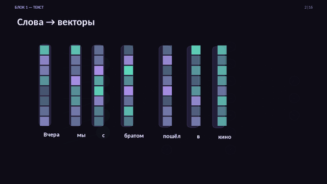
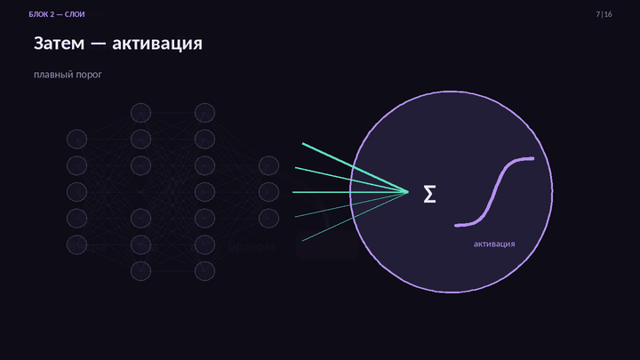
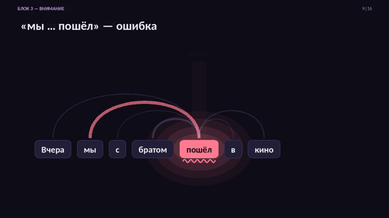
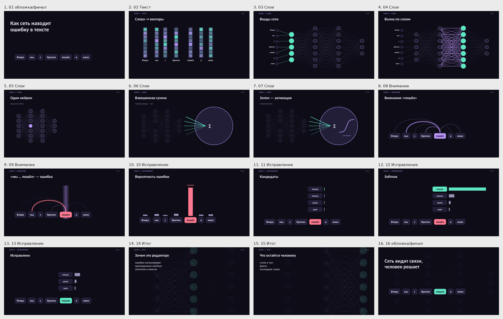
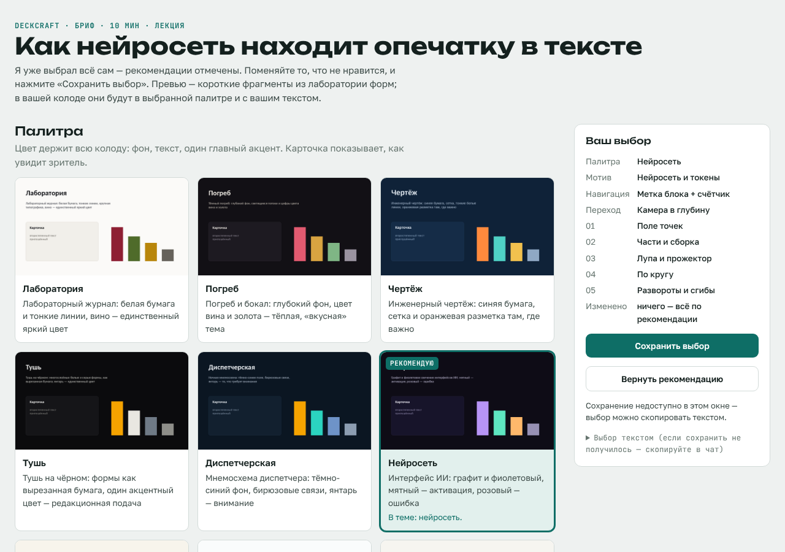

# deckcraft

**[Русский](#русский) · [English](#english)**

Плагин Claude Code для презентаций PowerPoint с переходом «Трансформация» (Morph): от брифа с опросом до
готового .pptx с проверкой движения.
A Claude Code plugin for PowerPoint decks with Morph transitions: from a brief with a visual survey to a
finished .pptx with motion checks.

<p align="center"></p>

---

## Русский

### Установка
В терминале:
```bash
claude plugin marketplace add animedeed/deckcraft
claude plugin install deckcraft@deckcraft
pip install python-pptx lxml Pillow numpy shapely
```
Или внутри Claude Code: `/plugin marketplace add animedeed/deckcraft`, затем `/plugin install deckcraft@deckcraft`
и `/reload-plugins`.

**Нужно:** Python 3.10+, LibreOffice (`soffice`) — для рендера миниатюр и проверки эффектов.

**Рекомендуется** для полной проверки файлов — скилл pptx от Anthropic (схемы OOXML для XSD-проверки и
обёртка рендера):
```bash
claude plugin marketplace add anthropics/skills
claude plugin install document-skills@anthropic-agent-skills
```
Без него всё работает, только XSD-проверка пропускается с подсказкой.

### Команды
| Команда | Что делает |
|---|---|
| `/deck-brief [тема или файл]` | Разбирает материал на разделы, задаёт короткий опрос и предлагает палитру, сквозной мотив, навигацию, переход между разделами и язык движения каждого раздела — каждое решение с причиной. «Доверить» — решает сам и показывает раскадровку; «настроить» — публикует страницу-витрину с GIF, где вы меняете выбор. |
| `/deck-build [brief.json]` | Собирает .pptx движком morphkit и проверяет: текст, контраст, пролёт фигур по тексту, XSD, эффекты в LibreOffice, миниатюры, GIF ключевых переходов. |
| `/deck-remix [pptx] [что поменять]` | Дорабатывает вашу готовую колоду, сохраняя удачное: скорость переходов, разрыв перелива текста, сигнал по линиям, связи графа без пересечений. |
| `/deck-review [pptx]` | Разбор как у дизайнера: таблица «серьёзность → слайд → правка» и эскиз движения каждого перехода, в том числе для чужих колод. |

В имени команды может понадобиться префикс плагина: `/deckcraft:deck-brief`.

### Что внутри
- **morphkit** — движок на python-pptx: мир-холст с камерой, 54 приёма Morph, петли «до конца слайда»,
  198 нативных анимаций и 53 перехода, векторная графика и псевдо-3D, проверки.
- **Сквозной мотив в ролях** (обложка, указатель у края, фон, диаграмма, финал) и **грамматика процесса**
  (носитель проходит через глаголы: разделить, закодировать, связать, оценить, отметить).
- **12 палитр** с причиной выбора, **лаборатория форм** (~300 вариантов движения в 25 семействах).
- Скилл **pptx-design**: композиция слайда, ритм колоды, структура (одна навигация, один тип перехода между
  разделами, свой язык движения у раздела).

### Пример
`plugins/deckcraft/skills/pptx-morph/scripts/examples/demo_deck.py` — колода «Как нейросеть находит опечатку»
с нуля по брифу (16 слайдов, одна фраза проходит через всю колоду). Раскадровка — `demo_storyboard.md` рядом.

<p align="center">


</p>
<p align="center"></p>

Страница опроса `/deck-brief` (режим «настроить»):
<p align="center"></p>

### Обновление
Плагин обновляется, когда в репозитории повышается версия в `plugin.json`:
```bash
claude plugin update deckcraft@deckcraft      # затем /reload-plugins в открытой сессии
```
Автообновление для сторонних маркетплейсов по умолчанию выключено. Включается так: `/plugin` → вкладка
Marketplaces → `deckcraft` → Enable auto-update.

### Что проверить в PowerPoint
LibreOffice не проигрывает Morph. Плавные переходы, перелив свободных форм, порядок слоёв во время перехода и
3D смотрите в PowerPoint 2019+ или 365. PowerPoint 2016 только воспроизводит Morph, более старые показывают
затухание.

### Участие
Идеи и ошибки — в [Issues](../../issues), правки — через Pull Request. Как добавить свой мотив, палитру или
приём — в [CONTRIBUTING.md](CONTRIBUTING.md).

Лицензия MIT.

---

## English

### Install
In a terminal:
```bash
claude plugin marketplace add animedeed/deckcraft
claude plugin install deckcraft@deckcraft
pip install python-pptx lxml Pillow numpy shapely
```
Or inside Claude Code: `/plugin marketplace add animedeed/deckcraft`, then `/plugin install deckcraft@deckcraft`
and `/reload-plugins`.

**Requires:** Python 3.10+ and LibreOffice (`soffice`) for thumbnails and the effects check.

**Recommended** for full file validation — Anthropic's pptx skill (OOXML schemas for the XSD check and a render
wrapper):
```bash
claude plugin marketplace add anthropics/skills
claude plugin install document-skills@anthropic-agent-skills
```
Without it everything works; the XSD check is skipped with a hint.

The skills are written in Russian. Claude reads them fine and answers in your language.

### Commands
| Command | What it does |
|---|---|
| `/deck-brief [topic or file]` | Splits your material into sections, asks a short survey and proposes a palette, a recurring motif, navigation, a section transition and a motion language per section, each with a reason. "Trust me" decides and shows a storyboard; "customize" publishes a survey page with GIF previews where you change the picks. |
| `/deck-build [brief.json]` | Builds the .pptx with the morphkit engine and checks it: text fit, contrast, shapes flying over text, XSD, LibreOffice effects import, thumbnails, GIFs of key transitions. |
| `/deck-remix [pptx] [what to change]` | Improves an existing deck while keeping what works: transition speed, no text re-flow, signals along lines, graph edges without crossings. |
| `/deck-review [pptx]` | A designer's critique: a severity → slide → fix table and a motion sketch of every transition, for any deck. |

You may need the plugin prefix: `/deckcraft:deck-brief`.

### What's inside
- **morphkit** — a python-pptx engine: world canvas with a camera, 54 Morph techniques, in-slide loops,
  198 native animations and 53 transitions, vector shapes and pseudo-3D, QA tools.
- **A motif with roles** (cover, edge pointer, backdrop, chart, finale) and a **process grammar** (a carrier
  goes through verbs: split, encode, relate, score, flag).
- **12 palettes** with reasons and a **form lab** (~300 motion variants in 25 families).
- The **pptx-design** skill: slide composition, deck rhythm, deck structure (one navigation system, one section
  transition, a motion language per section).

### Example
`plugins/deckcraft/skills/pptx-morph/scripts/examples/demo_deck.py` builds "How a neural net finds a typo" from
a brief (16 slides, one sentence carried through the whole deck). Storyboard: `demo_storyboard.md`.

### Updating
Users get a new version when `version` in `plugin.json` is bumped:
```bash
claude plugin update deckcraft@deckcraft      # then /reload-plugins in a running session
```
Auto-update is off by default for third-party marketplaces: `/plugin` → Marketplaces → `deckcraft` →
Enable auto-update.

### Check in PowerPoint
LibreOffice does not play Morph. Check smooth transitions, freeform morphing, layer order during a transition and
3D in PowerPoint 2019+ or 365. PowerPoint 2016 only plays Morph; older versions show a fade.

### Contributing
Ideas and bugs go to [Issues](../../issues), changes come as Pull Requests. See
[CONTRIBUTING.md](CONTRIBUTING.md) for adding a motif, palette or technique.

MIT license.
