# deckcraft

**[Русский](#русский) · [English](#english)**

Плагин Claude Code для презентаций PowerPoint с переходом «Трансформация» (Morph) и интерактивных
HTML-презентаций из тех же слайдов: от брифа с опросом до готового .pptx и/или одного HTML-файла с проверкой движения.
A Claude Code plugin for PowerPoint decks with Morph transitions and interactive HTML presentations built from the
same slides: from a brief with a visual survey to a finished .pptx and/or one HTML file, with motion checks.

<p align="center"></p>

---

## Русский

### Установка
В терминале:
```bash
claude plugin marketplace add animedeed/deckcraft
claude plugin install deckcraft@deckcraft
pip install python-pptx lxml Pillow numpy shapely
```
Или внутри Claude Code: `/plugin marketplace add animedeed/deckcraft`, затем `/plugin install deckcraft@deckcraft`
и `/reload-plugins`.

**Нужно:** Python 3.10+, LibreOffice (`soffice`) — для рендера миниатюр и проверки эффектов.

**Рекомендуется** для полной проверки файлов — скилл pptx от Anthropic (схемы OOXML для XSD-проверки и
обёртка рендера):
```bash
claude plugin marketplace add anthropics/skills
claude plugin install document-skills@anthropic-agent-skills
```
Без него всё работает, только XSD-проверка пропускается с подсказкой.

### Команды
| Команда | Что делает |
|---|---|
| `/deck-brief [тема или файл]` | Разбирает материал на разделы, задаёт короткий опрос и предлагает палитру, сквозной мотив, навигацию, переход между разделами и язык движения каждого раздела — каждое решение с причиной. «Доверить» — решает сам и показывает раскадровку; «настроить» — публикует страницу-витрину с GIF, где вы меняете выбор. |
| `/deck-build [brief.json]` | Собирает .pptx движком morphkit и проверяет: текст, контраст, пролёт фигур по тексту, XSD, эффекты в LibreOffice, миниатюры, GIF ключевых переходов. |
| `/deck-remix [pptx] [что поменять]` | Дорабатывает вашу готовую презентацию, сохраняя удачное: скорость переходов, разрыв перелива текста, сигнал по линиям, связи графа без пересечений. |
| `/deck-review [pptx]` | Разбор как у дизайнера: таблица «серьёзность → слайд → правка» и эскиз движения каждого перехода, в том числе для чужих презентаций. |

В имени команды может понадобиться префикс плагина: `/deckcraft:deck-brief`.

### Что внутри
- **morphkit** — движок на python-pptx: мир-холст с камерой, 54 приёма Morph, петли «до конца слайда»,
  198 нативных анимаций и 53 перехода, векторная графика и псевдо-3D, проверки.
- **Сквозной мотив в ролях** (обложка, указатель у края, фон, диаграмма, финал) и **грамматика процесса**
  (носитель проходит через глаголы: разделить, закодировать, связать, оценить, отметить).
- **12 палитр** с причиной выбора, **лаборатория форм** (~300 вариантов движения в 25 семействах).
- Скилл **pptx-design**: композиция слайда, ритм презентации, структура (одна навигация, один тип перехода между
  разделами, свой язык движения у раздела).
- **Web-движок (0.3.0)**: те же слайды — в один HTML-файл без зависимостей с настоящим Morph, 81 эффектом, живыми
  сценами, листами-переходами, элементами рисования, кнопками и окном докладчика; `.pptx`-двойник — из тех же слайдов.

### Пример
`plugins/deckcraft/skills/pptx-morph/scripts/examples/demo_deck.py` — презентация «Как нейросеть находит опечатку»
с нуля по брифу (16 слайдов, одна фраза проходит через всю презентацию). Раскадровка — `demo_storyboard.md` рядом.

<p align="center">


</p>
<p align="center"></p>

Страница опроса `/deck-brief` (режим «настроить»): можно отметить несколько вариантов, у каждого пункта — GIF-превью,
в углу — переключатель RU/EN.
<p align="center"></p>

После сборки вариантов — страница сравнения: одни и те же моменты презентации столбцами, выбор лучшего целиком или
сборка итога из частей.
<p align="center">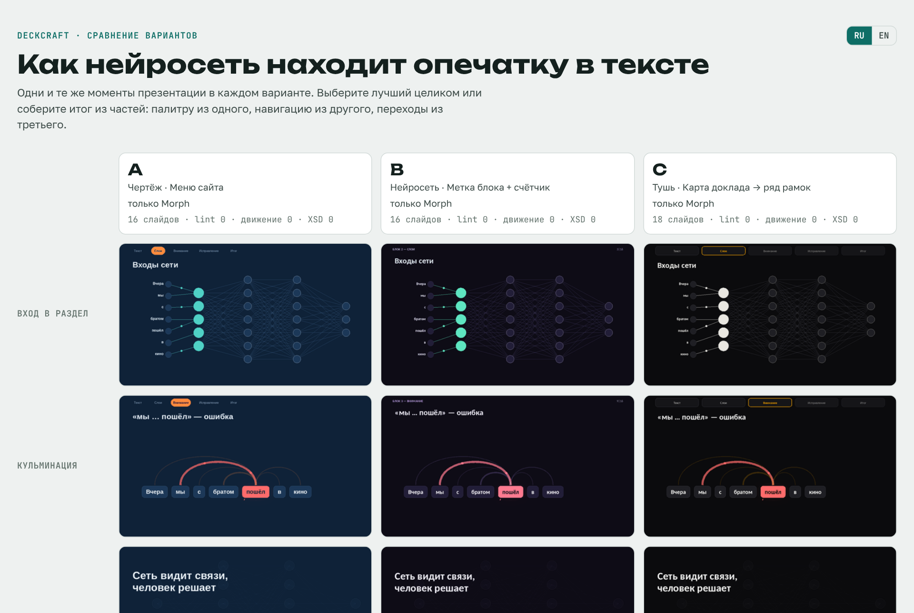</p>

### Web-презентации (HTML) — новое в 0.3.0
`/deck-brief` спрашивает формат: PowerPoint, интерактивный HTML или оба. HTML — один файл, открывается в любом
браузере: меню и числа — кнопки (метрика ведёт на слайд-доказательство, Backspace — назад), переключатели состояний
(столбики переезжают пружиной), пометки от руки (обвести, стрелка, рукопись, печать), живые сцены (жидкость,
частицы, сигнал по сети, прибор, терминал), 19 листов-переходов, обзор (O), окно докладчика с таймером (P), перо (D),
печать в PDF. Интерфейс показа — на языке презентации (RU/EN).
```bash
python examples/demo_web.py OUT --lang ru --shots      # из plugins/deckcraft/skills/pptx-morph/scripts
```
<p align="center">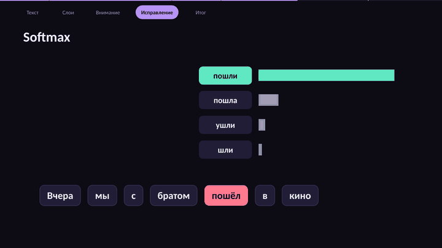</p>
<p align="center">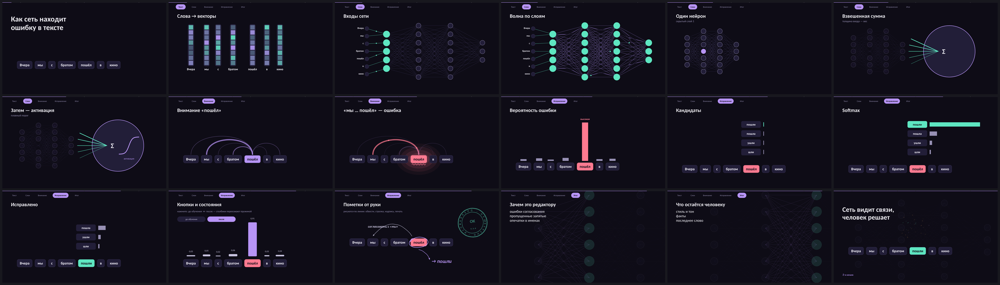</p>

Справочник — `plugins/deckcraft/skills/pptx-morph/references/web.ru.md`; для проверок нужен Playwright
(`pip install playwright && playwright install chromium`).

### Обновление
Плагин обновляется, когда в репозитории повышается версия в `plugin.json`:
```bash
claude plugin update deckcraft@deckcraft      # затем /reload-plugins в открытой сессии
```
Автообновление для сторонних маркетплейсов по умолчанию выключено. Включается так: `/plugin` → вкладка
Marketplaces → `deckcraft` → Enable auto-update.

**Claude Cowork (приложение):** Customize → Plugins → маркетплейс `deckcraft` → Update. Если версия не сменилась —
удалите плагин и установите заново из того же маркетплейса, затем полностью перезапустите приложение.

### Что проверить в PowerPoint
LibreOffice не проигрывает Morph. Плавные переходы, перелив свободных форм, порядок слоёв во время перехода и
3D смотрите в PowerPoint 2019+ или 365. PowerPoint 2016 только воспроизводит Morph, более старые показывают
затухание.

### 3D-модели (.glb) — в разработке, нужна помощь
Есть прототип (пока не в этом репозитории): плагин сам строит модели `.glb` (бокал, бочка, цветок, машина),
вставляет их в слайд как настоящие 3D-объекты PowerPoint с запасной картинкой и поворачивает «Трансформацией»,
умеет делить модель на части. Не получается довести без PowerPoint 365 под рукой: совпадение 2D-контуров с 3D-рамкой
(камера, масштаб, порядок поворотов), детализация моделей. Если вы работали со встроенным 3D в PowerPoint
(`am3d:model3d`, камеры, `objViewport`/`winViewport`) или делаете хорошие 3D-модели — откликнитесь в
[issue про 3D](https://github.com/animedeed/deckcraft/issues/1). Самостоятельно эта часть вряд ли будет закончена.

### Участие
Идеи и ошибки — в [Issues](../../issues), правки — через Pull Request. Как добавить свой мотив, палитру или
приём — в [CONTRIBUTING.md](CONTRIBUTING.md).

Лицензия MIT.

---

## English

### Install
In a terminal:
```bash
claude plugin marketplace add animedeed/deckcraft
claude plugin install deckcraft@deckcraft
pip install python-pptx lxml Pillow numpy shapely
```
Or inside Claude Code: `/plugin marketplace add animedeed/deckcraft`, then `/plugin install deckcraft@deckcraft`
and `/reload-plugins`.

**Requires:** Python 3.10+ and LibreOffice (`soffice`) for thumbnails and the effects check.

**Recommended** for full file validation — Anthropic's pptx skill (OOXML schemas for the XSD check and a render
wrapper):
```bash
claude plugin marketplace add anthropics/skills
claude plugin install document-skills@anthropic-agent-skills
```
Without it everything works; the XSD check is skipped with a hint.

The survey, comparison page, previews and demo come in English and Russian (`--lang en`). The internal skill
references are written in Russian; Claude reads them and answers in your language.

### Commands
| Command | What it does |
|---|---|
| `/deck-brief [topic or file]` | Splits your material into sections, asks a short survey and proposes a palette, a recurring motif, navigation, a section transition and a motion language per section, each with a reason. "Trust me" decides and shows a storyboard; "customize" publishes a survey page with GIF previews where you change the picks. |
| `/deck-build [brief.json]` | Builds the .pptx with the morphkit engine and checks it: text fit, contrast, shapes flying over text, XSD, LibreOffice effects import, thumbnails, GIFs of key transitions. |
| `/deck-remix [pptx] [what to change]` | Improves an existing deck while keeping what works: transition speed, no text re-flow, signals along lines, graph edges without crossings. |
| `/deck-review [pptx]` | A designer's critique: a severity → slide → fix table and a motion sketch of every transition, for any deck. |

You may need the plugin prefix: `/deckcraft:deck-brief`.

### What's inside
- **morphkit** — a python-pptx engine: world canvas with a camera, 54 Morph techniques, in-slide loops,
  198 native animations and 53 transitions, vector shapes and pseudo-3D, QA tools.
- **A motif with roles** (cover, edge pointer, backdrop, chart, finale) and a **process grammar** (a carrier
  goes through verbs: split, encode, relate, score, flag).
- **12 palettes** with reasons and a **form lab** (~300 motion variants in 25 families).
- The **pptx-design** skill: slide composition, deck rhythm, deck structure (one navigation system, one section
  transition, a motion language per section).
- **Web engine (0.3.0)**: the same slides as one self-contained HTML file with real Morph, 81 effects, live scenes,
  sheet transitions, drawn elements, buttons and a presenter view; the `.pptx` twin comes from the same slides.

### Example
<p align="center">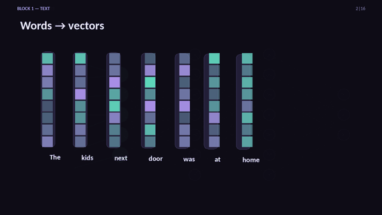</p>
<p align="center">
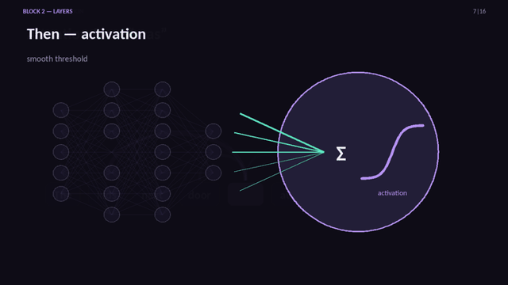
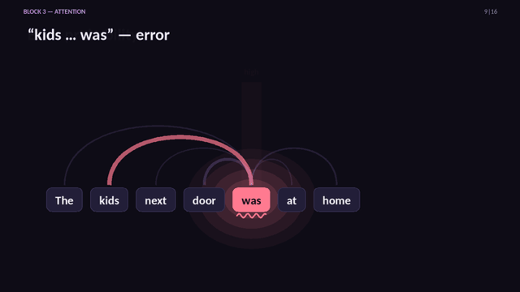
</p>
<p align="center">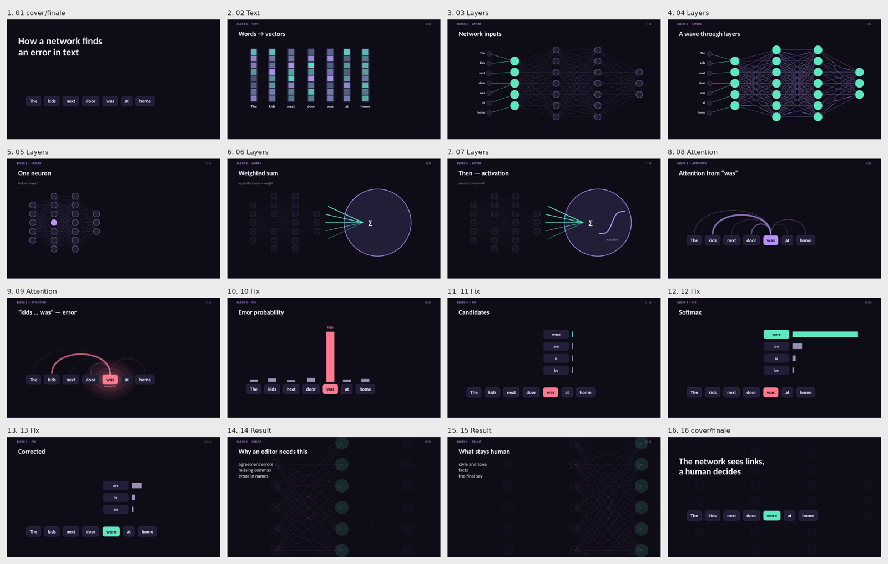</p>

`plugins/deckcraft/skills/pptx-morph/scripts/examples/demo_deck.py` builds "How a neural network finds a typo" from
a brief (16 slides, one sentence — “The kids next door was at home” — carried through the whole presentation).
Run it with `--lang en` for English, without for Russian. Storyboard: `demo_storyboard.md`.

The `/deck-brief` survey page ("customize" mode): tick several options, every item has a GIF preview, RU/EN switch
in the corner.
<p align="center">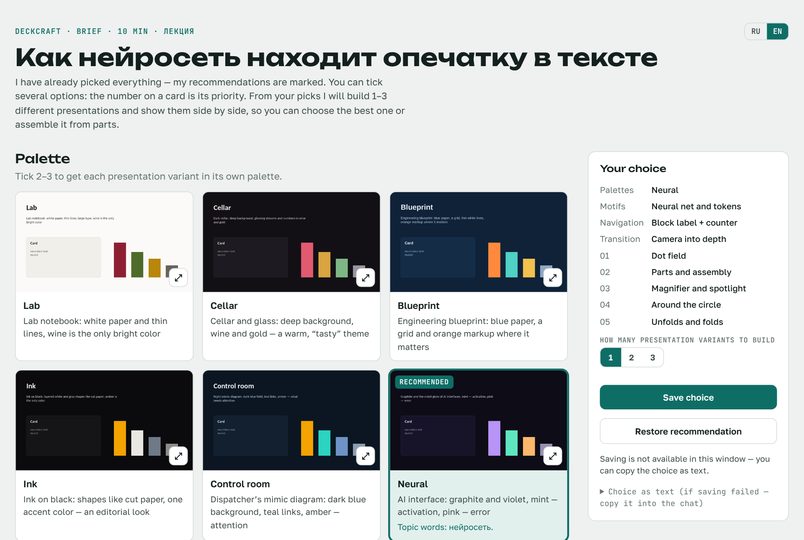</p>

After the variants are built — the compare page: the same moments of each presentation side by side; take the best
one or assemble the result from parts.
<p align="center">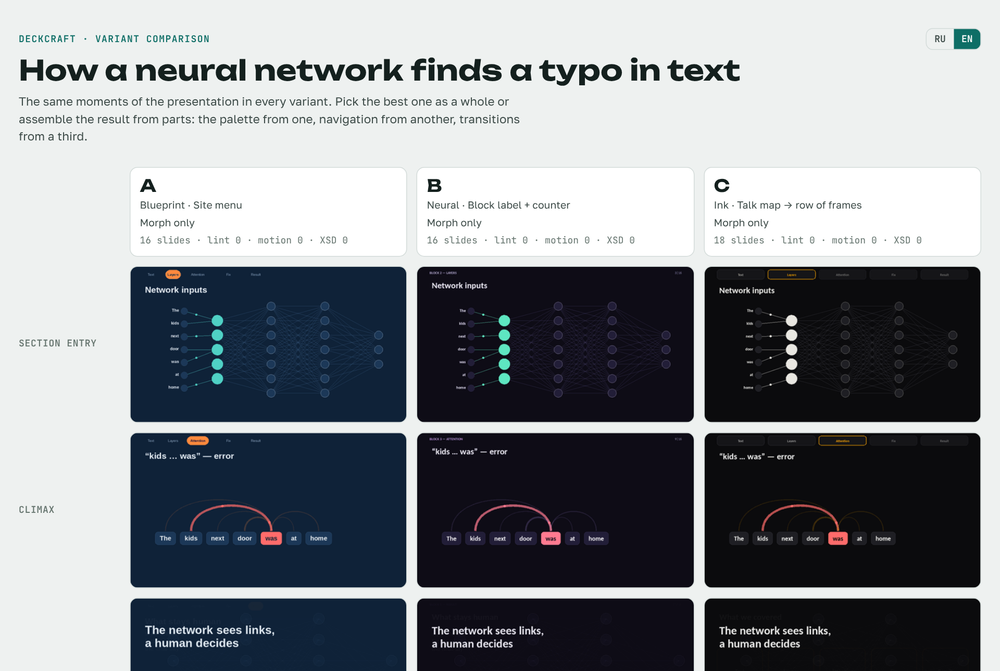</p>

### Web presentations (HTML) — new in 0.3.0
`/deck-brief` asks for the format: PowerPoint, interactive HTML or both. The HTML is one file that opens in any
browser: the menu and the numbers are buttons (a metric leads to its evidence slide, Backspace goes back), state
switches (bars spring to new heights), hand annotations (circle, arrow, handwriting, stamp), live scenes (liquid,
particles, a signal through a network, a gauge, a terminal), 19 sheet transitions, overview (O), presenter view with
a timer (P), pen (D), print to PDF. The presenter UI follows the presentation language (RU/EN).
```bash
python examples/demo_web.py OUT --lang en --shots      # from plugins/deckcraft/skills/pptx-morph/scripts
```
<p align="center">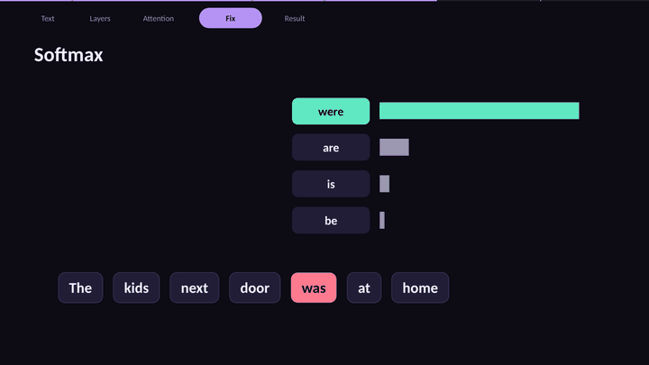</p>
<p align="center">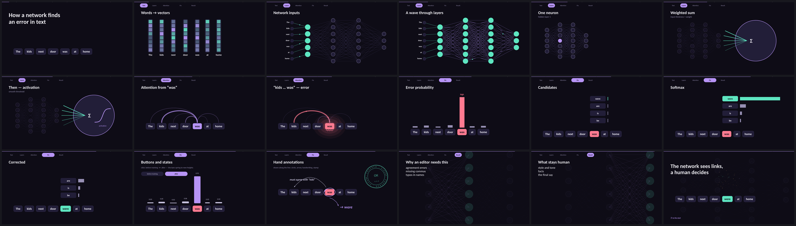</p>

Reference: `plugins/deckcraft/skills/pptx-morph/references/web.md`; the checks need Playwright
(`pip install playwright && playwright install chromium`).

### Updating
Users get a new version when `version` in `plugin.json` is bumped:
```bash
claude plugin update deckcraft@deckcraft      # then /reload-plugins in a running session
```
Auto-update is off by default for third-party marketplaces: `/plugin` → Marketplaces → `deckcraft` →
Enable auto-update.

**Claude Cowork (desktop app):** Customize → Plugins → the `deckcraft` marketplace → Update. If the version does not
change, uninstall the plugin, install it again from the same marketplace and fully restart the app.

### Check in PowerPoint
LibreOffice does not play Morph. Check smooth transitions, freeform morphing, layer order during a transition and
3D in PowerPoint 2019+ or 365. PowerPoint 2016 only plays Morph; older versions show a fade.

### 3D models (.glb) — in progress, help wanted
There is a prototype (not in this repository yet): the plugin builds `.glb` models itself (a glass, a barrel, a
flower, a car), embeds them as native PowerPoint 3D objects with a fallback picture, turns them with Morph and can
split a model into parts. It can't be finished without PowerPoint 365 at hand: matching 2D outlines to the 3D frame
(camera, scale, rotation order) and model detail. If you have worked with PowerPoint's built-in 3D (`am3d:model3d`,
cameras, `objViewport`/`winViewport`) or make good 3D models, please join the [3D issue](https://github.com/animedeed/deckcraft/issues/1).
This part is unlikely to be finished by the maintainer alone.

### Contributing
Ideas and bugs go to [Issues](../../issues), changes come as Pull Requests. See
[CONTRIBUTING.md](CONTRIBUTING.md) for adding a motif, palette or technique.

MIT license.
